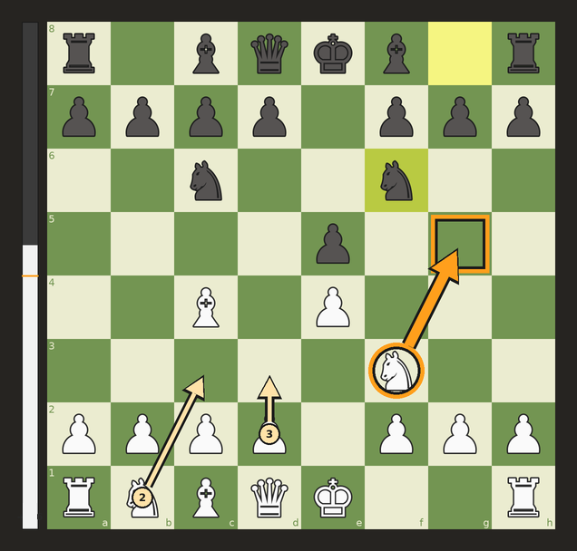

# ♞ Chess Overlay

A small Windows app that reads the chess board on your screen and draws the engine's best move on top of it. It works with **Chess.com**, **Lichess** and **RoChess on Roblox**, plus most other flat 2-D boards in any colours. I made it for experiments against **bots**.

<p align="center">
  
  <br><sub>Illustration made from a simulated board (not a real screenshot)</sub>
</p>

> **Fair play:** use this against bots, in analysis, or for experiments like the one it was built for. Getting engine help in games against other people is cheating. It breaks the rules of Chess.com, Lichess and RoChess, and accounts get banned for it.

## Download

Get **`Chess Overlay.exe`** from the [**Releases**](../../releases/latest) page and double-click it. You don't need to install anything.

- GitHub builds the .exe from the code in this repository (see [the workflow](.github/workflows/build.yml)).
- The .exe isn't code-signed, so Windows may show *"Windows protected your PC"*. Click **More info → Run anyway**.
- On first run it downloads the [Stockfish](https://stockfishchess.org/) chess engine from Stockfish's official GitHub releases. This takes about a minute, and the panel shows the progress.

## What it does

- **Finds the board by itself.** It recognises Chess.com and Lichess colours, and any other two-colour board after a short search. If it doesn't find yours, click **Select board…** and drag a box around it.
- **Learns your piece set** from a starting position (one time per board style), then keeps improving as you play.
- **Works out whose turn it is** from the last-move highlight, whatever its colour. It also works if you play black (flipped board).
- **Draws the move** as a click-through orange arrow. A circle marks the piece and a box marks the square it goes to. Thin numbered arrows show the 2nd and 3rd best moves, and an **eval bar** sits beside the board.
- **Strength slider.** The suggestions can play like a ~1350 Elo player or anything up to full strength.
- **Experiment log.** It counts how often you played the suggested move and writes every position, suggestion and actual move to `experiment_log.csv`.
- **F8** hides or shows the arrows. The arrow window is hidden from screen capture, so it never confuses the board reader.

## Using it

1. Open the app, then start a game against a bot.
2. **First time only:** make sure a fresh game (the starting position) is on screen, so it can learn the pieces.
3. On your turn, follow the orange arrow (or don't — that's the experiment).

The control panel also shows a mini board of what the app thinks the position is. If an arrow ever looks wrong, check that first.

**RoChess / Roblox tips**
- If the arrows don't appear over Roblox in fullscreen, press **F11** in Roblox to switch to a window (maximised is fine).
- Click **Find board** after resizing the window.
- The app only reads the screen. It never touches the game.
- It reads flat, top-down boards only. It can't read a tilted 3-D board.

Settings, learned pieces, the log and the engine live in `%APPDATA%\Chess Overlay` (the **Open app folder** button in the panel goes there).

## Run from source / build the .exe yourself

You need Windows 10 (2004+) or 11 and Python 3.9+ with tkinter (the standard python.org installer has it).

| File | What it does |
| --- | --- |
| `Start Chess Overlay.bat` | Installs `numpy` + `mss` the first time, then runs `chess_overlay.py` |
| `Build EXE.bat` | Builds `Chess Overlay.exe` with PyInstaller in a private `build\` environment (1–3 min) |

Or by hand:

```bat
pip install numpy mss
python chess_overlay.py
```

## How it works

1. It screenshots just the board area (with [mss](https://github.com/BoboTiG/python-mss)) and splits it into 64 squares.
2. It compares each square's silhouette and shading with thumbnails of your pieces that it saved from the starting position. Squares it isn't sure about make it wait for a clearer frame instead of guessing.
3. It turns the position into a FEN: whose turn it is, castling rights from which kings and rooks have moved, and en passant from the highlight. It checks the FEN is legal.
4. It sends the FEN to Stockfish over UCI (MultiPV 3, with optional `UCI_LimitStrength`).
5. It draws the result on a transparent, click-through Tk window that Windows excludes from screen capture.

Everything is in one file, [`chess_overlay.py`](chess_overlay.py).

## Tests

```bash
pip install numpy pillow pytest
pytest tests
```

The tests draw simulated boards: Chess.com and Lichess colours, Roblox-style boards with grid lines and busy backgrounds, both orientations and several sizes. They check that a full game is read correctly move by move, including castling, en passant and promotion. They also cover the move scoring, the engine wrapper (against a fake engine) and the engine download. They run automatically on every push.

## License

The code in this repository is under the [MIT License](LICENSE).
[Stockfish](https://github.com/official-stockfish/Stockfish) is separate GPLv3 software. The app downloads it from Stockfish's official releases and doesn't include it.
